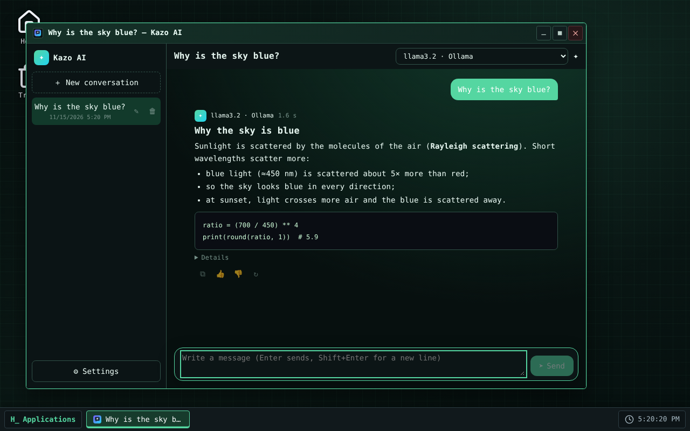
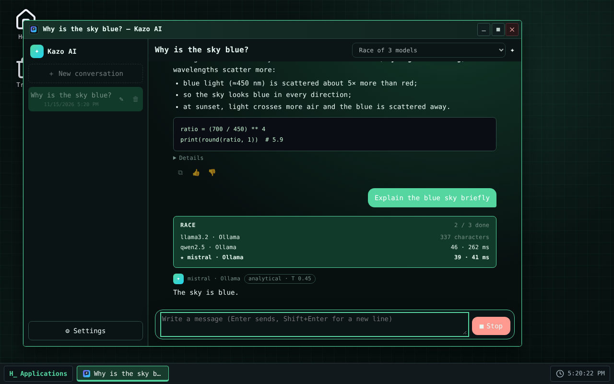
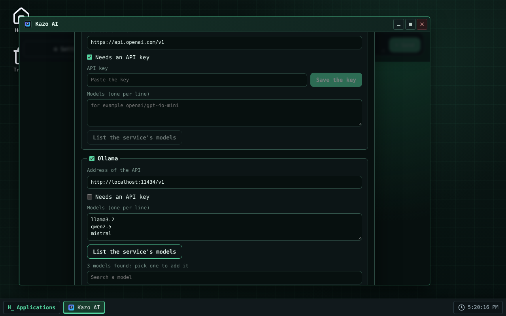
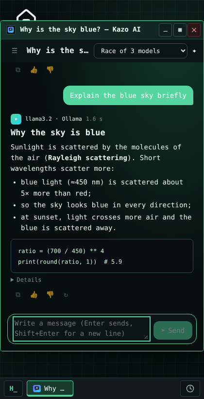

> [Version française](readme-fr.md)

<!-- Store listing: generated from store/ by .github/scripts/store-readme.mjs. Edit store/, then run it. -->


# Kazo AI

A chat with AI models for Kazo OS, written in C# and Blazor, on a computer and on a phone. Bring
your own API keys, or run a model directly in your browser: nothing to install, no account needed.

## Your models, your keys

- **OpenRouter, OpenAI, Ollama, LM Studio**, and any service that speaks the OpenAI chat API: add
  its address, paste your key, list its models and pick one.
- Keys stay in the **Kazo OS keyring** and are sent only to their own service, straight from the
  browser. They are never written to a file and never exported.
- Answers are streamed as they are written, in Markdown, with code blocks and tables.

## A local model, on your graphics card

- No key? Kazo AI runs a small open model **in the browser with WebGPU** (WebLLM): Qwen, Llama,
  Phi, Gemma and others. The model is downloaded once and kept in the browser cache.
- What you write to the local model never leaves your computer.
- It loads by itself at start when already downloaded, and takes over when the chosen service has
  no key.

## Race and AutoTune

- **Race mode** asks several models at once, scores their answers as they arrive, shows the
  leader live, and keeps the best one, with the full ranking.
- **AutoTune** reads the conversation (code, writing, analysis, small talk...) and sets the
  temperature and the other sampling parameters for each answer. Rate answers with 👍 and 👎 and it
  learns your taste; or choose a fixed strategy, or set everything by hand.

## Personas and modules

- Personas (assistant, developer, writer, teacher, or your own) give the system prompt of a
  conversation.
- **Modules** change the request before it leaves or the answer before it is shown: a few are
  built in, more can be imported as simple JSON files, and developers can compile their own C#
  modules into the app.
- Settings, personas and modules are exported and imported as one JSON file.

## Administrator approval

Kazo AI asks for access to the **real network** (`network.real.access`) to reach the AI services
and to download the local model. Kazo OS asks an administrator to approve it at the first launch.

## Screenshots

<p>
  
  
  
  
</p>

<!-- /Store listing -->

## Try it

[Open Kazo AI in Kazo OS](https://os.kazo.ca/?autolaunch=ca.kazo.ai): the link starts Kazo OS, installs the app from the official Store and opens it.

Or open [Kazo OS](https://os.kazo.ca/) and install Kazo AI from the **Kazo OS Store** (category Productivity), or in the Kazo OS Terminal, as an administrator: `sudo kazopkg install Kazo-ca/Os-App-AI`.

## About Kazo OS

[Kazo OS](https://github.com/Kazo-ca/Os) is a simulated operating system that runs in the browser, written in C# with Blazor WebAssembly. It gives a complete environment to build and run applications: desktop and windows, a persistent file system, processes, a POSIX shell, a simulated network, the Kazo OS Store, and a public SDK (NuGet packages) to make apps such as this one. Try it at <https://os.kazo.ca/> (PWA, works offline).

## Development

- Architecture of the code: [English](doc/en/architecture.md) · [Français](doc/fr/architecture.md)
- Writing modules (JSON and C#): [English](doc/en/modules.md) · [Français](doc/fr/modules.md)
- AI services, local model and data formats: [English](doc/en/providers.md) · [Français](doc/fr/providers.md)
- License: MIT ([LICENSE](LICENSE)); third-party works: [THIRD-PARTY-NOTICES.md](THIRD-PARTY-NOTICES.md).

### Build and run

```bash
git clone --recurse-submodules https://github.com/Kazo-ca/Os-App-AI.git
cd Os-App-AI
dotnet run --project src/Kazo.Ai.Os      # Kazo OS with the Kazo AI app
```

The `external/KazoOs` submodule is Kazo OS on its release tag (3.3.4): it gives the version of the
Kazo OS packages. `Debug` builds the OS from the submodule's sources, `Release` takes the packages
from nuget.org (what CI and the Kazo OS Store build).

### Tests

```bash
dotnet build Kazo.Ai.slnx -c Release
dotnet test Kazo.Ai.slnx -c Release --no-build
dotnet build src/Kazo.Ai -c Release -t:KazoOsPack   # the Store package: one assembly, lib/Kazo.Ai.dll
```

### Credits

The race between models, the AutoTune of the sampling parameters and the learning from ratings were
inspired by the open-source project [G0DM0D3](https://github.com/elder-plinius/G0DM0D3) by
elder-plinius. Kazo AI is a separate implementation in C#: it contains none of its code, prompts or
content. The data shapes of these features (sampling parameters, context types, race events) follow
the same names, documented in [providers.md](doc/en/providers.md).
