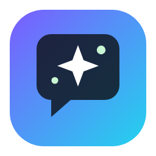
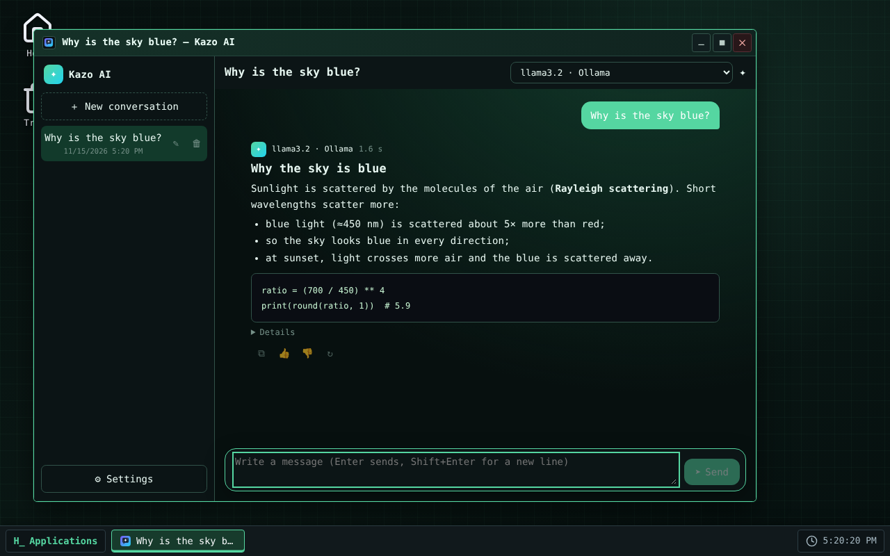
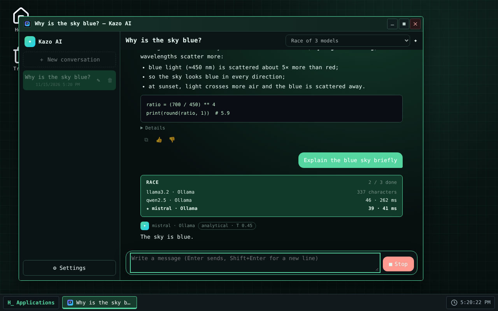
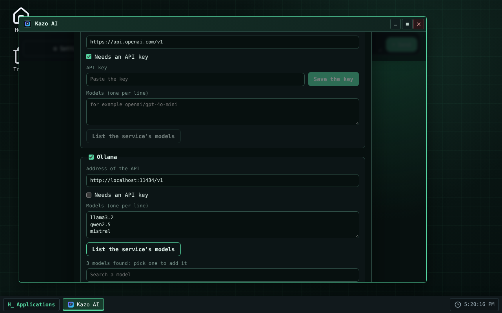
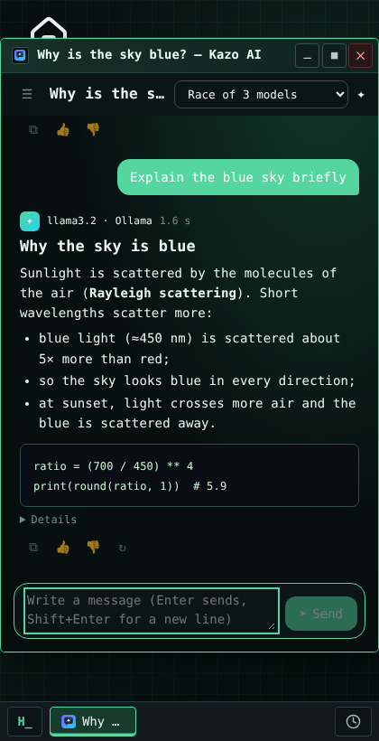

> [English version](README.md)

<!-- Fiche du Store : générée depuis store/ par .github/scripts/store-readme.mjs. Modifiez store/, puis lancez-le. -->



# Kazo IA

Une discussion avec des modèles d'IA pour Kazo OS, écrite en C# et Blazor, sur ordinateur et sur
téléphone. Apportez vos propres clés d'API, ou faites tourner un modèle directement dans votre
navigateur : rien à installer, aucun compte nécessaire.

## Vos modèles, vos clés

- **OpenRouter, OpenAI, Ollama, LM Studio**, et tout service qui parle l'API de chat d'OpenAI :
  ajoutez son adresse, collez votre clé, listez ses modèles et choisissez-en un.
- Les clés restent dans le **trousseau de Kazo OS** et ne sont envoyées qu'à leur propre service,
  directement depuis le navigateur. Elles ne sont jamais écrites dans un fichier ni exportées.
- Les réponses s'affichent à mesure qu'elles s'écrivent, en Markdown, avec blocs de code et
  tableaux.

## Un modèle local, sur votre carte graphique

- Pas de clé ? Kazo IA fait tourner un petit modèle ouvert **dans le navigateur avec WebGPU**
  (WebLLM) : Qwen, Llama, Phi, Gemma et d'autres. Le modèle est téléchargé une fois et gardé dans le
  cache du navigateur.
- Ce que vous écrivez au modèle local ne quitte jamais votre ordinateur.
- Il se charge tout seul au démarrage s'il est déjà téléchargé, et prend le relais quand le service
  choisi n'a pas de clé.

## Course et AutoTune

- Le **mode course** interroge plusieurs modèles à la fois, note leurs réponses à mesure qu'elles
  arrivent, montre le meneur en direct et garde la meilleure, avec le classement complet.
- **AutoTune** lit la conversation (code, écriture, analyse, bavardage...) et règle la température et
  les autres paramètres d'échantillonnage pour chaque réponse. Notez les réponses avec 👍 et 👎 et il
  apprend vos goûts ; ou choisissez une stratégie fixe, ou réglez tout à la main.

## Personas et modules

- Les personas (assistant, développeur, écrivain, professeur, ou les vôtres) donnent le prompt
  système d'une conversation.
- Les **modules** changent la requête avant son départ ou la réponse avant son affichage : quelques-uns
  sont intégrés, d'autres s'importent comme de simples fichiers JSON, et les développeurs peuvent
  compiler leurs propres modules C# dans l'app.
- Réglages, personas et modules s'exportent et s'importent en un seul fichier JSON.

## Approbation de l'administrateur

Kazo IA demande l'accès au **réseau réel** (`network.real.access`) pour joindre les services d'IA
et télécharger le modèle local. Kazo OS demande à un administrateur de l'approuver au premier
lancement.

## Captures d'écran

<p>
  
  
  
  
</p>

<!-- /Fiche du Store -->

## Essayer

[Ouvrir Kazo IA dans Kazo OS](https://os.kazo.ca/?autolaunch=ca.kazo.ai) : le lien démarre Kazo OS, installe l'app depuis le Store officiel et l'ouvre.

Ou ouvrez [Kazo OS](https://os.kazo.ca/) et installez Kazo IA depuis le **Kazo OS Store** (catégorie Productivité), ou dans le Terminal de Kazo OS, en administrateur : `sudo kazopkg install Kazo-ca/Os-App-AI`.

## À propos de Kazo OS

[Kazo OS](https://github.com/Kazo-ca/Os) est un système d'exploitation simulé qui tourne dans le navigateur, écrit en C# avec Blazor WebAssembly. Il offre un environnement complet pour créer et exécuter des applications : bureau et fenêtres, système de fichiers persistant, processus, shell POSIX, réseau simulé, le Kazo OS Store, et un SDK public (paquets NuGet) pour faire des apps comme celle-ci. Essayez-le sur <https://os.kazo.ca/> (PWA, fonctionne hors ligne).

## Développement

- Architecture du code : [Français](doc/fr/architecture.md) · [English](doc/en/architecture.md)
- Écrire des modules (JSON et C#) : [Français](doc/fr/modules.md) · [English](doc/en/modules.md)
- Services d'IA, modèle local et formats de données : [Français](doc/fr/providers.md) · [English](doc/en/providers.md)
- Licence : MIT ([LICENSE](LICENSE)) ; œuvres tierces : [THIRD-PARTY-NOTICES.md](THIRD-PARTY-NOTICES.md).

### Compiler et lancer

```bash
git clone --recurse-submodules https://github.com/Kazo-ca/Os-App-AI.git
cd Os-App-AI
dotnet run --project src/Kazo.Ai.Os      # Kazo OS avec l'app Kazo IA
```

Le sous-module `external/KazoOs` est Kazo OS sur son tag de version (3.3.4) : il donne la version des
paquets Kazo OS. `Debug` compile l'OS depuis les sources du sous-module, `Release` prend les paquets
de nuget.org (ce que la CI et le Kazo OS Store compilent).

### Tests

```bash
dotnet build Kazo.Ai.slnx -c Release
dotnet test Kazo.Ai.slnx -c Release --no-build
dotnet build src/Kazo.Ai -c Release -t:KazoOsPack   # le paquet du Store : un seul assembly, lib/Kazo.Ai.dll
```

### Remerciements

La course entre modèles, l'AutoTune des paramètres d'échantillonnage et l'apprentissage par les notes
s'inspirent du projet libre [G0DM0D3](https://github.com/elder-plinius/G0DM0D3) d'elder-plinius.
Kazo IA en est une implémentation distincte en C# : elle ne contient aucun de son code, de ses prompts
ni de son contenu. Les formes de données de ces fonctions (paramètres d'échantillonnage, types de
contexte, événements de course) reprennent les mêmes noms, décrits dans
[providers.md](doc/fr/providers.md).
